# Сапёр: Магазин (saper-vk)

Классический сапёр 9×9 с мета-прогрессией: монеты за открытые клетки и магазин подсказок.
Формат — **VK Mini App** (мобильный веб-вью внутри ВКонтакте), поэтому всё заточено под
вертикальный экран телефона: крупные тапы, тёмная тема, safe-area.

Стек: **React 19 + TypeScript (strict) + Vite**. Без сторонних UI- и анимационных библиотек —
только CSS и инлайновые SVG. Звук — Web Audio API, без файлов. Из внешнего есть только
`@vkontakte/vk-bridge` (инициализация мини-приложения и хранилище прогресса).

| Старт | Каскад | Флажок |
| --- | --- | --- |
| 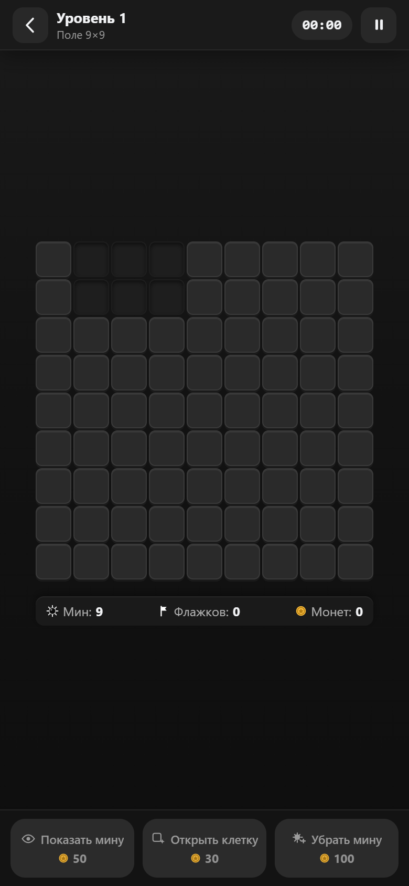 |  |  |

| Взрыв | Поле после взрыва | Победа |
| --- | --- | --- |
|  |  | 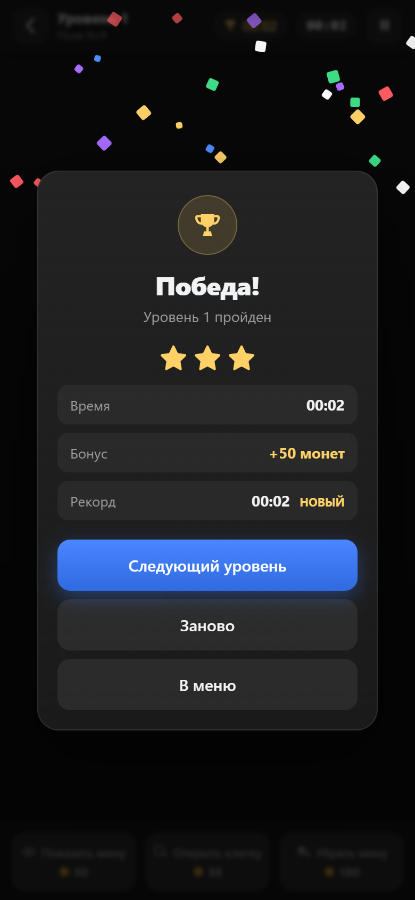 |

| Магазин (всё доступно) | «Показать мину» | «Убрать мину» |
| --- | --- | --- |
|  |  |  |

| После победы и перезагрузки: уровень 2, рекорд, монеты | После траты 100 монет и перезагрузки |
| --- | --- |
|  |  |

Меню и разделы:

| Хаб: кампания, задачи дня, сложности | Низ хаба: разделы |
| --- | --- |
| 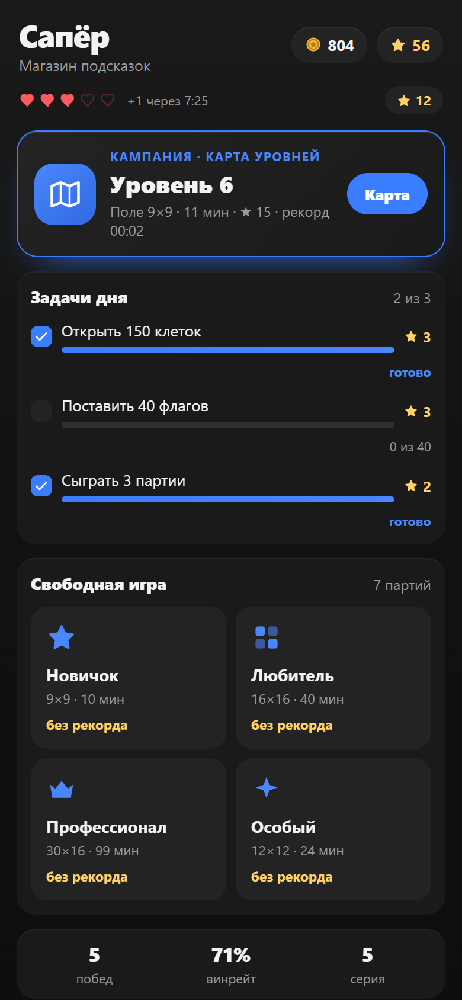 | 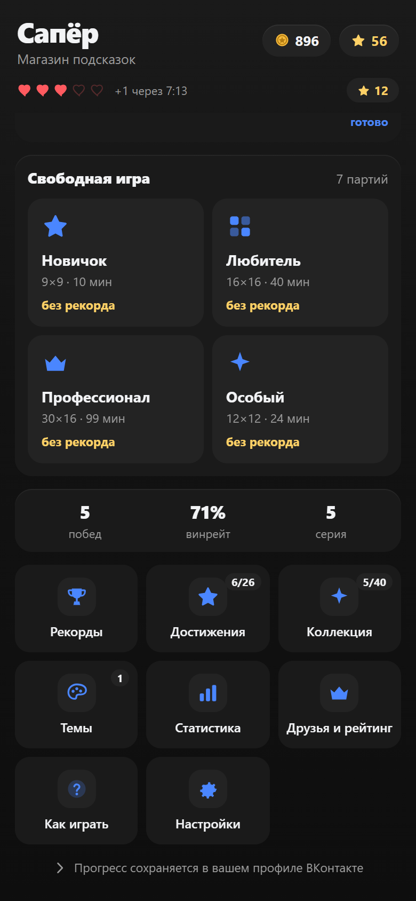 |

Кампания — карта уровней, у каждого уровня своя фигура из мин:

| Карта уровней | Низ карты: закрытые уровни |
| --- | --- |
| 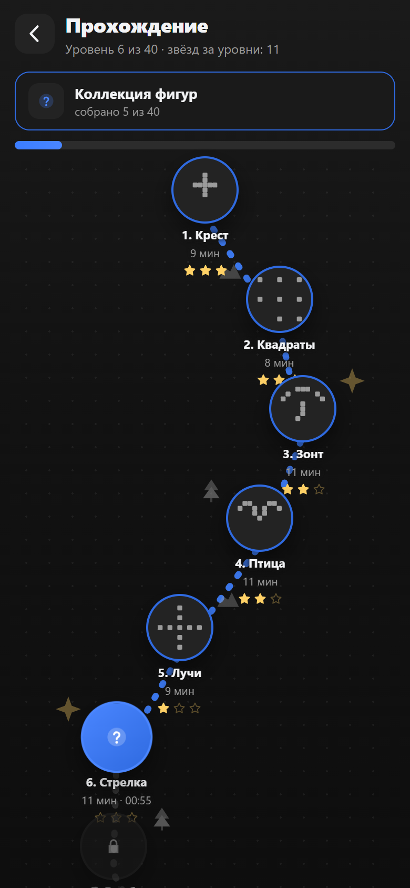 | 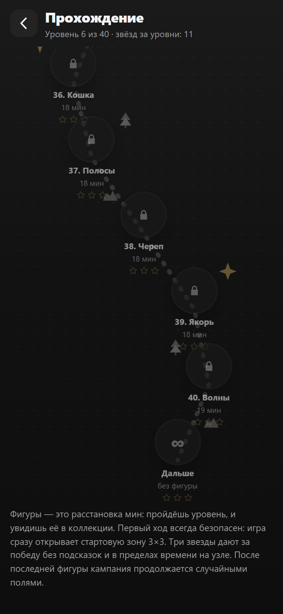 |

| Коллекция фигур | Друзья и рейтинг | Жизни в шапке |
| --- | --- | --- |
| 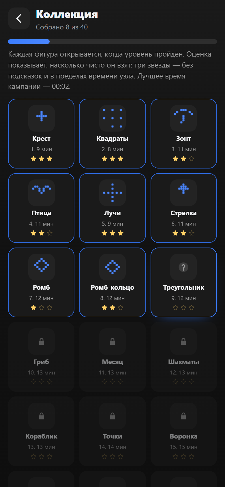 | 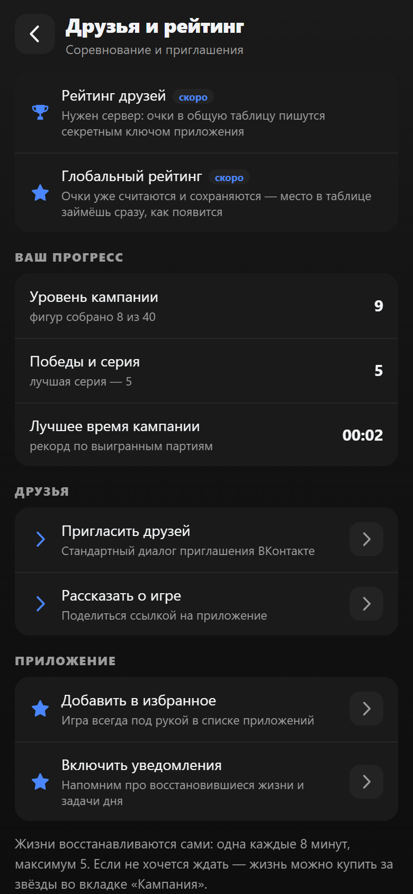 | 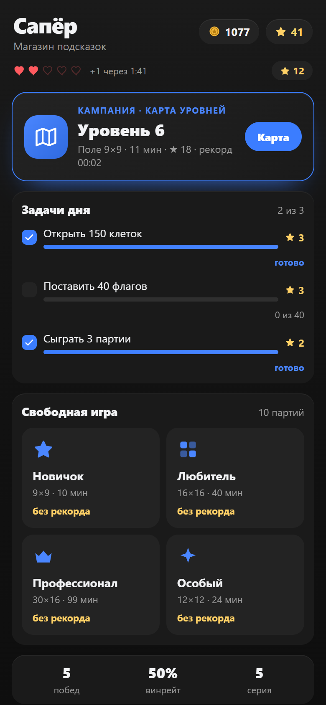 |

| Уровень «Рыбка» после проигрыша | Уровень «Танк» | Уровень «Кошка» |
| --- | --- | --- |
| 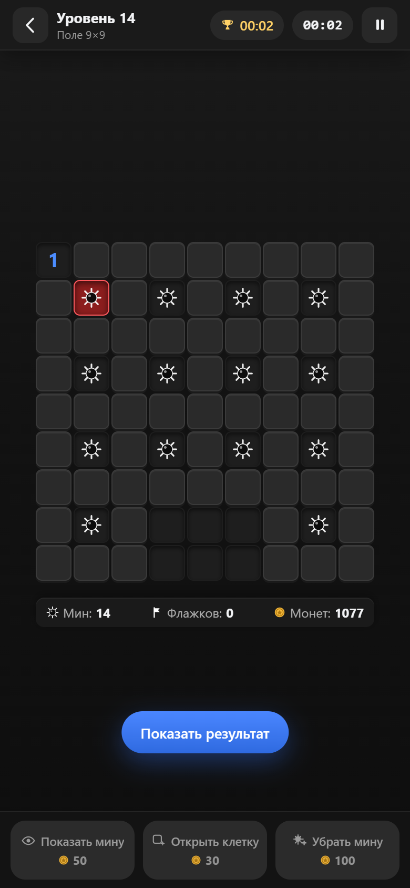 | 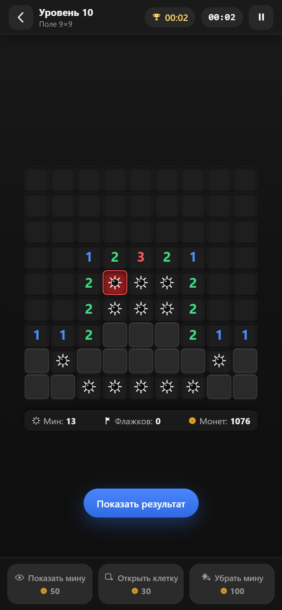 | 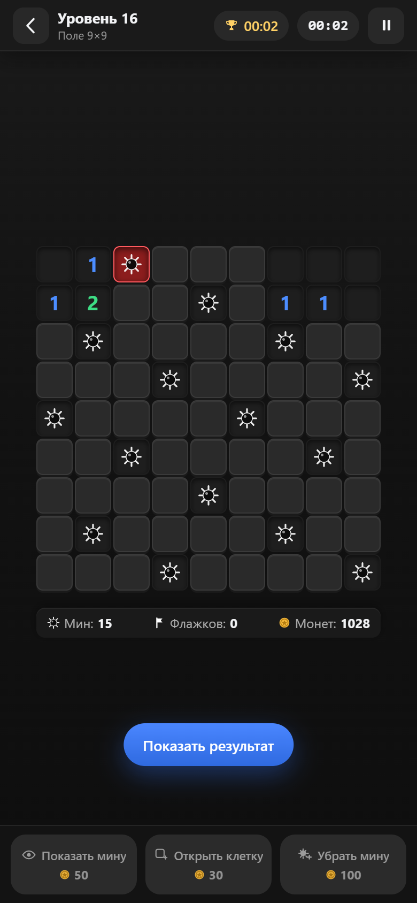 |

| Темы оформления | Достижения | Статистика |
| --- | --- | --- |
| 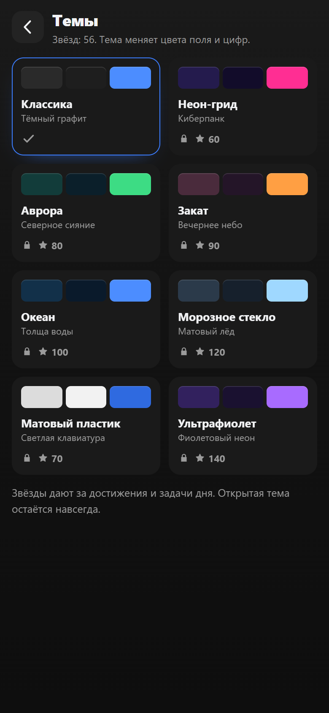 | 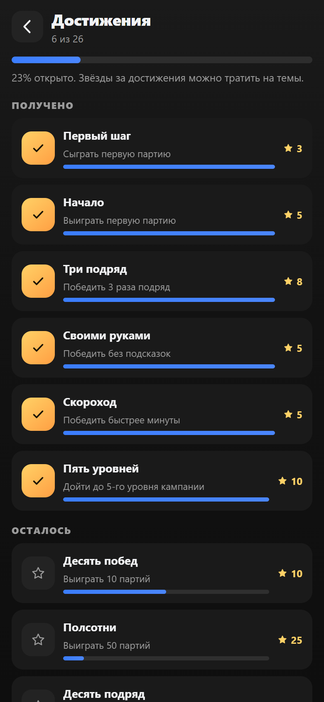 | 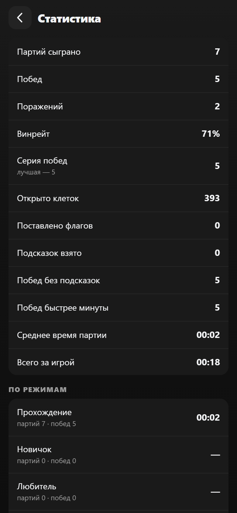 |

| Рекорды по режимам | Настройки | Как играть |
| --- | --- | --- |
| 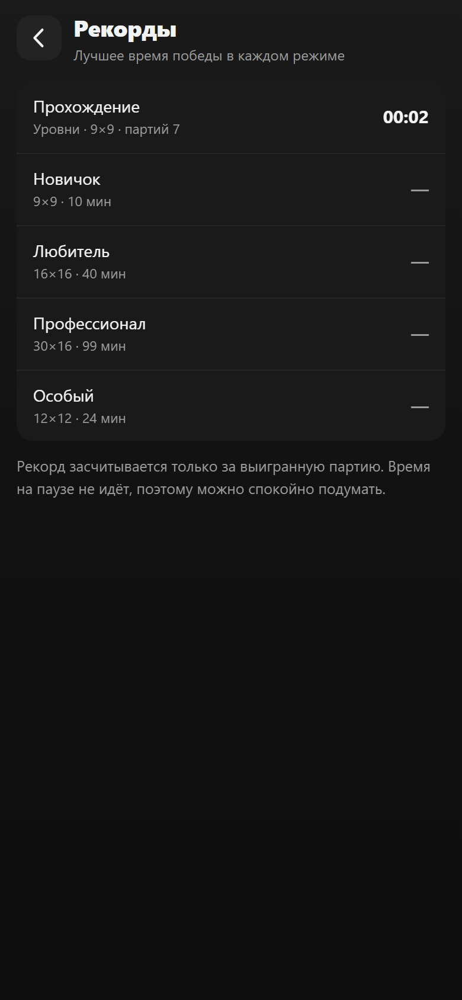 | 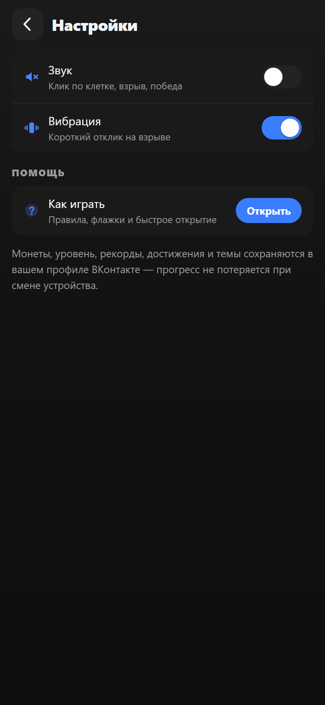 | 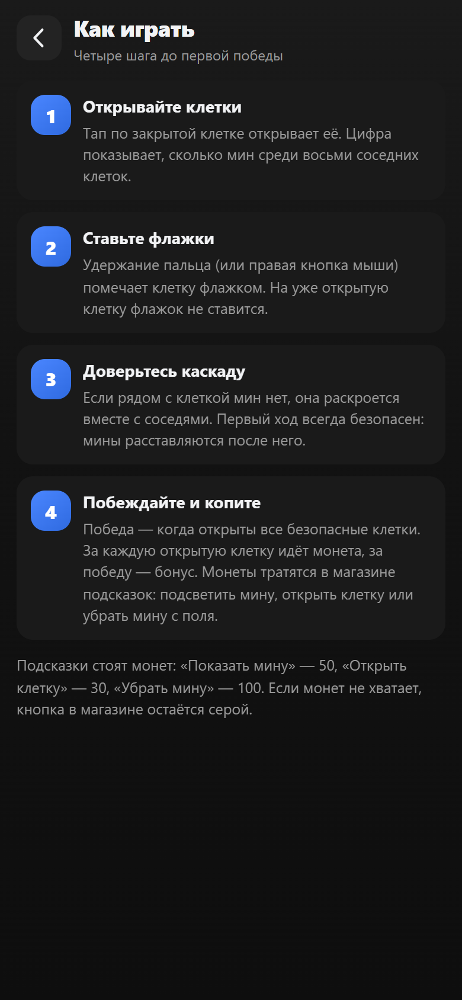 |

Поля свободной игры:

| 16×16, 40 мин | 30×16, 99 мин | Светлая тема |
| --- | --- | --- |
| 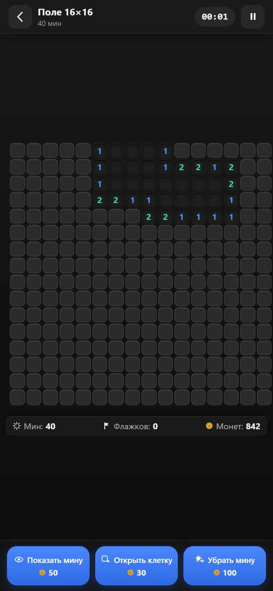 | 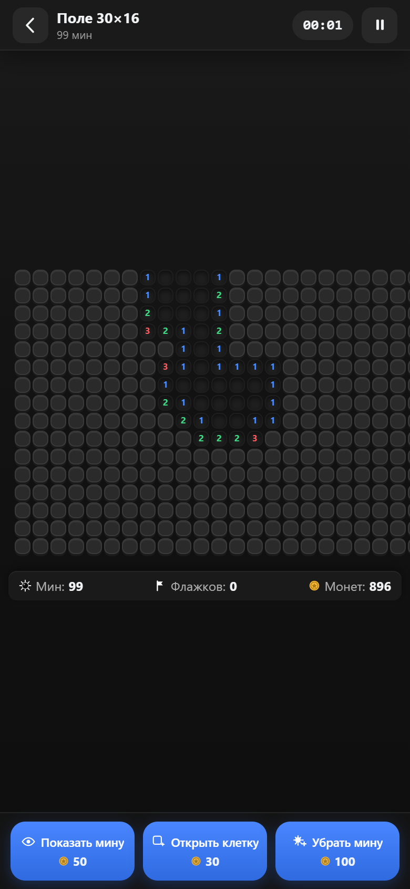 | 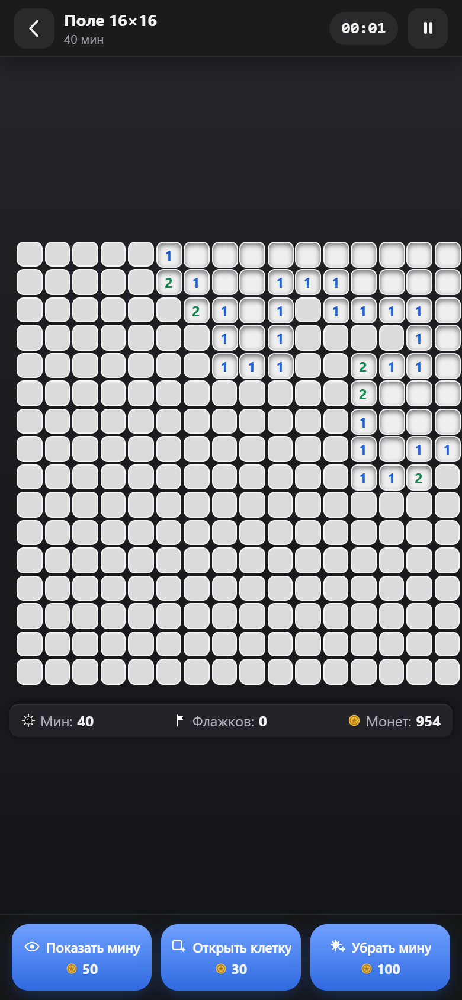 |

| Анимированная иконка: 4 кадра из 2-секундного цикла | Цвет фона за иконкой |
| --- | --- |
| 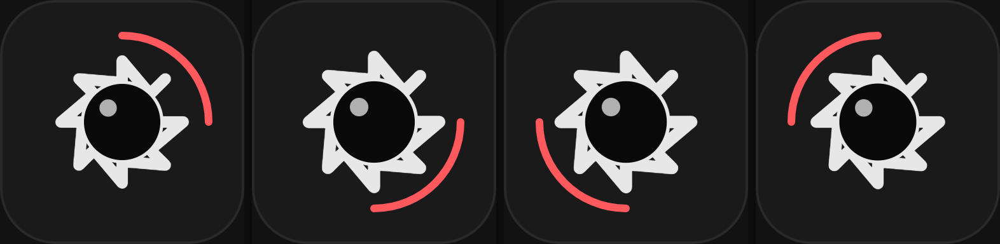 | 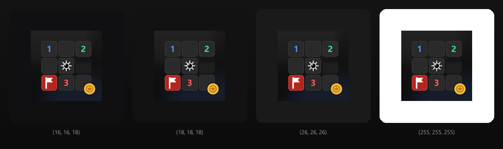 |

## Статус проекта

| Шаг | Что делает | Состояние |
| --- | --- | --- |
| 1 | Каркас (Vite + React + TS), типы, генерация поля, открытие/флажки, тесты | ✅ готово |
| 2 | Визуал: тёмная тема, клетки, анимации, TopBar, таймер, пауза, монеты | ✅ готово |
| 3 | Магазин подсказок, строка статуса, сохранение звука в VK Storage | ✅ готово |
| 4 | VK-интеграция: монеты, уровень, рекорд в VK Storage | ✅ готово |
| 5 | README: сборка, деплой, создание Mini App, локальная отладка без туннеля | ✅ готово |
| 6 | Мета-слой: хаб, свободная игра (9×9, 16×16, 30×16, 12×12), темы, достижения, статистика, рекорды, задачи дня, настройки | ✅ готово |

## Быстрый старт

```bash
npm install      # или: pnpm install
npm run dev      # http://localhost:5173
npm run build    # production-сборка в dist/
npm run preview  # локальный просмотр собранной версии
npm test         # тесты (vitest)
npm run typecheck
```

Требуется Node.js 20.19+ / 22.12+ (нужно для Vite 7).

## Деплой

Приложению нужен **HTTPS**: ВКонтакте открывает мини-приложение в iframe и не примет
незащищённый адрес. Серверная часть не нужна — `npm run build` собирает статику в `dist/`.

### Vercel

1. Залей проект в GitHub.
2. [vercel.com](https://vercel.com) → **Add New… → Project** → выбери репозиторий.
3. Framework Preset: **Vite**, Build Command: `npm run build`, Output Directory: `dist`.
4. **Deploy** → получишь `https://<проект>.vercel.app`.

### Netlify

1. [app.netlify.com](https://app.netlify.com) → **Add new site → Import an existing project**.
2. Build command: `npm run build`, Publish directory: `dist`.
3. **Deploy site**.

### GitHub Pages

1. В `vite.config.ts` уже стоит `base: './'` — сборка работает и из подкаталога.
2. `npm run build`
3. Опубликуй содержимое `dist/` в ветку `gh-pages`:
   ```bash
   npx gh-pages -d dist
   ```
   либо через Actions (`actions/upload-pages-artifact` + `actions/deploy-pages`).
4. Settings → Pages → Source: ветка `gh-pages`.
   Адрес: `https://<логин>.github.io/<репозиторий>/`.

### Любой другой хостинг

`dist/` — обычная статика, подойдёт любой HTTPS-хостинг (Cloudflare Pages, S3 + CloudFront,
свой nginx с сертификатом). Для локальной проверки сборки — `npm run preview`
(`http://localhost:4173`), но для ВК нужен публичный HTTPS.

## Как создать Mini App во ВКонтакте

1. **Приложение.** [dev.vk.com](https://dev.vk.com) → «Мои приложения» → «Создать
   приложение» → тип **Mini App** (мобильное веб-вью). Укажи название и платформу.
2. **URL.** В настройках приложения найди поле **«Адрес приложения» / Base URL** и вставь
   HTTPS-адрес из деплоя (например `https://saper-vk.vercel.app`). Если приложение живёт
   в подкаталоге (GitHub Pages), укажи полный путь со слэшем на конце.
3. **Иконки.** В настройках → «Иконки»: загрузи квадратные PNG 16, 24, 32, 48, 64, 128 и
   256 px. Они нужны для каталога мини-приложений и обложки.
4. **VKWebAppInit** уже вызывается в `src/main.tsx` — это обязательный шаг, без него
   приложение не откроется внутри ВК. Если ВК не ответил за 2 секунды, игра стартует
   на localStorage (проверено: вне ВК она полностью работоспособна).
5. **Локальная отладка внутри ВК (VK Tunnel).** Важно: **VK Tunnel недоступен** — с 2 октября
   2025 года сервис на технических работах и возвращает ошибку (это указано в
   [официальной инструкции](https://dev.vk.com/ru/mini-apps/getting-started)). Варианты:
   - **проще всего** — задеплоить на Vercel/Netlify и открывать `https://vk.com/app<APP_ID>`;
   - для локальной сборки — сторонний туннель с публичным HTTPS
     (`ngrok http 5173` или `cloudflared tunnel --url http://localhost:5173`), а полученный
     адрес указать в **«Режим разработки»**.
6. **Приоритет адресов.** Для администраторов адрес выбирается так: тестовая группа →
   **режим разработки** → **URL**. Поэтому перед проверкой боевой сборки **выключи «Режим
   разработки»** во всех площадках, иначе ты как админ продолжишь видеть старый адрес.
7. **Проверка на телефоне.** Открой приложение в мобильном ВК: тёмная тема, safe-area,
   таймер, магазин подсказок. Перезагрузи приложение — монеты, уровень и рекорд должны
   остаться. Неопубликованное приложение в мобильном ВК открывается так: отправь ссылку
   `https://vk.com/app<APP_ID>` в «Избранное» и запусти её оттуда.
8. **Чего настраивать не нужно:** CORS (VK Bridge общается через `postMessage`, а не через
   XHR), «Доверенный redirect URL» и «Базовый домен» (это поля приложений типа «Веб-сайт»),
   защищённый ключ (пока нет сервера). Единственное, чего стоит избегать, — заголовки
   `X-Frame-Options: DENY` и CSP `frame-ancestors 'none'`: с ними приложение не загрузится
   в `<iframe>` на vk.com. У Vercel и Netlify по умолчанию таких заголовков нет.

## Оформление (иконки и сниппет)

Все изображения для панели ВК рисуются скриптом — композицию и цвета можно поправить
и пересобрать одной командой:

```bash
python scripts/make-art.py        # по умолчанию пишет в art/
```

| Файл | Размер | Куда в панели |
| --- | --- | --- |
| `art/icon-universal-576.png` | 576×576 | Универсальная иконка (каталог, лента, сниппеты) |
| `art/icon-catalog-278.png` | 278×278 | Иконка для каталога и сниппетов |
| `art/icon-small-150.png` | 150×150 | Маленькая иконка (экран запуска, сообщения, уведомления) |
| `art/favicon-32.png` | 32×32 | Фавикон (1.3 КБ при лимите 50 КБ) |
| `art/icon-loading-fallback-96.png` | 96×96 | Статичная иконка 96×96 (запасной вариант, если анимированную не загружаем) |
| `art/snippet-1120x630.png` и `.jpg` | 1120×630 | Большой сниппет (оба формата принимаются) |
| `art/preview-icon-sizes.png` | — | Превью: как иконка читается в разных размерах (не для загрузки) |
| `art/preview-icon-background.png` | — | Превью: как иконка смотрится на разных цветах фона |

Рисунок повторяет визуальный язык игры: тёмный градиент, объёмные закрытые клетки,
мина с белыми шипами, классические цвета цифр (1 синий, 2 зелёный, 3 красный), флажок
на красном и золотая монета магазина. Сетка занимает **70% кадра** — при круглой маске
углы не срезаются. На размерах меньше 200 px композиция упрощается (2×2 вместо 3×3),
а на 32 px остаётся только мина: мелкие детали там всё равно не читаются.

### Анимированная иконка (Lottie)

Панель ВК принимает анимированную иконку 96×96 в формате Lottie JSON не больше 24 КБ.
Она собирается кодом, а не в редакторе:

```bash
python scripts/make-lottie.py     # art/icon-loading-96.json — 5.8 КБ, 5 слоёв, цикл 2 с
```

Что в анимации: мина на тёмной плашке и красное кольцо-спиннер, которое делает оборот
за 2 секунды. Кольцо читается как «идёт загрузка», мина — как игра.

Проверить, что файл действительно рисуется (а не просто валиден по схеме), можно так —
скрипт отдаёт JSON настоящему плееру lottie-web в headless Chrome, снимает восемь кадров
и проверяет по пикселям, что на месте плашка, красное кольцо и белые шипы:

```bash
node scripts/verify-lottie.mjs    # требует полного доступа к системе: Chrome
```

### Цвет фона за иконкой

В панели по умолчанию стоит `#FFFFFF`. Ставьте **`#121212`** — тот же цвет, что у фона
приложения: плашка анимированной иконки скруглена, и на белом углы будут белыми квадратами
(см. `preview-icon-background.png`).

### Промовидео

Записывается из настоящего приложения: скрипт поднимает статический сервер над `dist/`,
открывает игру в headless Chrome, включает CDP-скринкаст и прогоняет партию, а второй
скрипт собирает кадры в MP4 с интро и аутро:

```bash
VITE_DEV_BRIDGE=1 npx vite build
node scripts/capture-video.mjs    # кадры и таймкоды → .video-work/
python scripts/make-video.py      # арт + сжатие пауз + ffmpeg → art/promo-1080x1920.mp4
```

Требуется полный доступ к системе (Chrome) и `ffmpeg` в `.tools`:

```bash
python -m pip install --target .tools imageio-ffmpeg
```

Длительность — 16 секунд при лимите 30: интро, каскад, подсказка «Показать мину»,
победа и следующий уровень. Длинные статичные паузы скрипт сжимает до 1.1 с, иначе
экран результата «зависает» в кадре.

В `art/` лежит **черновик** `promo-draft-1080x1920.mp4`: запись сделана до правки
сценария, и партия в нём заканчивается взрывом (клетки для «добора монет» выбирались
случайно и попали на мину). Боевой файл собирается двумя командами выше — сценарий уже
исправлен, он открывает только заведомо безопасные клетки.

## Структура

```
saper-vk/
├─ src/
│  ├─ game/
│  │  ├─ types.ts     типы: Cell, GameState, MetaState, Stats, DailyState, ModeId, ThemeId
│  │  ├─ random.ts    детерминированный PRNG (mulberry32) + shuffle + deriveSeed
│  │  ├─ clock.ts     часы партии: старт / пауза / стоп / формат MM:SS
│  │  ├─ board.ts     генерация поля, мины, цифры, удаление мины, геометрия
│  │  ├─ reveal.ts    открытие, каскад, флажки, монеты, победа/проигрыш
│  │  ├─ shop.ts      каталог подсказок, выбор цели, применение
│  │  ├─ modes.ts     режимы: кампания и свободная игра (9×9, 16×16, 30×16, 12×12)
│  │  ├─ patterns.ts  фигуры уровней кампании (ASCII-арт) + проверка арта
│  │  ├─ themes.ts    витрина тем (палитры лежат в styles.css)
│  │  ├─ lives.ts     жизни: регенерация по времени, трата, покупка
│  │  ├─ stats.ts     статистика и рекорды по режимам
│  │  ├─ achievements.ts 26 достижений с прогрессом и звёздами
│  │  ├─ daily.ts     задачи дня: набор по дате, счётчики, автонаграда
│  │  ├─ meta.ts      исход партии → статистика, достижения, звёзды; покупка тем
│  │  ├─ progress.ts  что сохраняем между сессиями и как разбираем хранилище
│  │  └─ useGame.ts   стейт-машина: редьюсер + хук (часы, таймеры, звук, сохранение)
│  ├─ audio/sfx.ts    синтез звуков на Web Audio API (клик, бум, победа, пшик, подсказка)
│  ├─ vk/
│  │  ├─ bridge.ts    VKWebAppInit + обёртки VKWebAppStorage
│  │  └─ storage.ts   прогресс: VK Storage внутри ВК, localStorage в браузере
│  ├─ screens/
│  │  ├─ HomeScreen.tsx          хаб: кампания, задачи дня, сложности, разделы
│  │  ├─ GameScreen.tsx          поле, магазин, модалки + отладочный мост
│  │  ├─ LevelMapScreen.tsx      карта кампании: узлы-фигуры, звёзды, замки
│  │  ├─ CollectionScreen.tsx    коллекция пройденных фигур
│  │  ├─ SocialScreen.tsx        друзья, приглашения, «рейтинг скоро»
│  │  ├─ StatsScreen.tsx         статистика и разбивка по режимам
│  │  ├─ RecordsScreen.tsx       лучшее время по режимам
│  │  ├─ ThemesScreen.tsx        витрина тем: включить или купить за звёзды
│  │  ├─ AchievementsScreen.tsx  получено / осталось, шкалы и награды
│  │  ├─ SettingsScreen.tsx      звук, вибрация, помощь
│  │  └─ HowToPlayScreen.tsx     инструкция из четырёх шагов
│  ├─ components/
│  │  ├─ TopBar.tsx        режим, рекорд, таймер, пауза, назад
│  │  ├─ ScreenShell.tsx   каркас раздела: шапка с «назад» + прокрутка
│  │  ├─ Stars.tsx         оценка уровня: три звезды
│  │  ├─ Hearts.tsx        жизни: сердечки, таймер, покупка
│  │  ├─ NoLivesModal.tsx  «жизни закончились» + покупка за звёзды
│  │  ├─ PatternPreview.tsx силуэт фигуры уровня
│  │  ├─ Board.tsx         сетка любого размера: волна раскрытия + тряска
│  │  ├─ Cell.tsx          клетка: тап/удержание, анимации
│  │  ├─ StatusBar.tsx     мин / флажков / монет под полем
│  │  ├─ ShopBar.tsx       три кнопки подсказок
│  │  ├─ GameOverModal.tsx «Взрыв!» / «Победа!»
│  │  ├─ PauseModal.tsx    пауза: продолжить / заново / в меню / звук
│  │  ├─ Modal.tsx         каркас оверлея (+ подсмотр поля)
│  │  ├─ Confetti.tsx      30 точек на CSS
│  │  ├─ Toast.tsx         всплывашка снизу
│  │  └─ icons.tsx         инлайновые SVG-иконки
│  ├─ hooks/useToast.ts
│  ├─ dev.ts           признак отладочной сборки (мост и параметры ссылки)
│  ├─ App.tsx, main.tsx, styles.css
│  └─ vite-env.d.ts
├─ tests/             board, reveal, shop, clock, progress, useGame, bridge, playthrough,
│                     catalog, stats, daily, achievements, meta, patterns, lives (214 тестов)
│                     + helpers.ts (партия на классическом уровне и безопасный первый ход)
├─ art/               иконки, Lottie-анимация, сниппет, промовидео для панели ВК
├─ screenshots/       снимки состояний и разделов (генерирует scripts/screenshot.mjs)
├─ scripts/
│  ├─ screenshot.mjs     скриншоты состояний и разделов + проверка прогресса через CDP
│  ├─ serve-dist.mjs     мини-сервер над dist/ для проверок (vite preview требует esbuild)
│  ├─ make-art.py        генератор оформления (иконки, сниппет, превью фона)
│  ├─ make-lottie.py     генератор анимированной иконки (Lottie JSON)
│  ├─ verify-lottie.mjs  рендер Lottie в Chrome + проверка по пикселям
│  ├─ capture-video.mjs  запись партии в кадры через CDP-скринкаст
│  └─ make-video.py      сборка MP4: интро/аутро, сжатие пауз, ffmpeg
├─ index.html, vite.config.ts, tsconfig.json, package.json
```

## Правила игры

Игра начинается с меню: кампания, свободная игра по сложностям, задачи дня и разделы.
Кампания — прежняя: поле 9×9, сложность растёт с уровнем. Свободная игра — фиксированные
классические поля со своими рекордами.

| Режим | Поле | Мины |
| --- | --- | --- |
| Прохождение | 9×9, мины по фигуре уровня | 9–18 (см. карту) |
| Новичок | 9×9 | 10 |
| Любитель | 16×16 | 40 |
| Профессионал | 30×16 (классика Windows) | 99 |
| Особый | 12×12 | 24 |

**Кампания — 40 уровней-фигур.** У каждого уровня нарисованная расстановка мин:
крест, квадраты, зонт, птица, лучи, стрелка, ромб, ромб-кольцо, треугольник, гриб, месяц,
шахматы, кораблик, точки, воронка, соты, зигзаг, косые, домик, ёлка, ракета, молния, танк,
флаг, ключ, корона, рамка, уголки, штрихи, крест-Х, диагонали, кубок, рыбка, сердце,
снежинка, кошка, полосы, череп, якорь, волны. Часть фигур нарисована руками, часть
собирается формулами (`shape` в `src/game/patterns.ts`), поэтому новый уровень — это
несколько строк кода. После 40-го кампания продолжается случайными полями.

Сложность равна числу мин в фигуре, и порядок подобран так: **лёгкий старт (8–12 мин),
постепенный рост до 19 и «передышки»** — после трёх-четырёх плотных уровней идёт фигура
на 14 мин. Проверяется тестами: первые пять уровней не плотнее 12 мин, средние последних
десяти выше средних первых, разница между соседями не больше четырёх мин.

На уровнях с фигурой **мины стоят сразу**, а «первый клик безопасен» обеспечивает
стартовая зона: игра сама открывает 3×3 вокруг точки `S`, и часы при этом не запускаются.
Зона именно 3×3, без каскада — на разреженных фигурах каскад раскрыл бы всё поле.

**Фигуру нельзя заучить.** После проигрыша поле раскрывается (как в классическом сапёре),
поэтому каждая попытка получает своё отражение фигуры по зерну партии — раскладка другая,
а фигура та же. Плюс силуэт на карте и в коллекции показывается только у пройденных
уровней: до победы фигура — секрет.

**Оценка уровня** — 1–3 звезды: три дают за победу без подсказок в пределах времени
на узле карты (`5` секунд на мину, минимум `25`), две — вдвое дольше или одна подсказка.
Оценка только растёт, а разница при улучшении падает в кошелёк звёзд.

**Жизни.** Кампания тратит по одной жизни за проигрыш (свободная игра — тренировка, там
жизни не тратятся). Всего 5, восстанавливаются по одной каждые 8 минут — отсчёт виден в
шапке меню и на карте. Если жизней нет, уровень не запустится: появится модалка с таймером
и предложением купить жизнь за 12 звёзд. Жизни, восстановившиеся, пока игра была закрыта,
досчитываются при запуске: хранится число жизней и момент последнего пересчёта, а не таймер.

Клетка поля сжимается под ширину экрана (не мельче 15 px), поэтому 16×16 влезает целиком,
а 30×16 прокручивается по горизонтали. Размер считает CSS из переменной `--cols`, которую
ставит игровой экран.

- **Мины расставляются на первом клике** в свободной игре и на уровнях без фигуры,
  поэтому первая открытая клетка всегда безопасна. Вместе с ней свободна и её 3×3 зона.
- Пустые клетки открываются каскадом (итеративно, обход в ширину).
- **Монеты:** +1 за каждую открытую безопасную клетку (каскад считается), +50 бонусом за победу.
- **Звёзды:** премиальная валюта. Дают за достижения, задачи дня и оценку уровней,
  тратятся на темы оформления.
- **Таймер** стартует на первом открытии, останавливается на паузе и на экране результата.
  **Рекорд** — лучшее время победы, своё у каждого режима.
- Флажок — удержание клетки (≈380 мс) или правый клик. На открытую клетку флажок не ставится.
  На телефоне удержание не запускает выделение текста: у клеток `user-select: none` и
  `-webkit-touch-callout: none`, контекстное меню гасится ещё и на уровне поля, а таймер
  удержания снимается по `pointerup`/`pointercancel` на `window` — иначе жест мог «залипнуть»
  и поле переставало отвечать на тапы.
- **Победа** — когда открыты все безопасные клетки (флажки в условии победы не участвуют);
  оставшиеся мины помечаются флажками автоматически.
- **Проигрыш** — клик по мине: вспышка клетки, тряска поля, раскрытие всех мин.
- На экране результата тап мимо карточки прячет оверлей — поле можно рассмотреть
  (кнопка «Показать результат» возвращает карточку).

### Что даёт мета-слой

- **Задачи дня** — три задания, которые обновляются каждый день. Набор выводится из даты
  (хеш `YYYY-MM-DD`), поэтому сервер не нужен, а у всех игроков в один день он одинаковый.
  Награда начисляется сама, как только цель достигнута.
- **Достижения** — 26 целей с прогрессом: победы, серии, открытые клетки, флажки, подсказки,
  победы без подсказок и быстрее минуты, победы в каждом режиме, уровни кампании, время в игре.
  Прогресс считается функцией от статистики, поэтому отдельного счётчика «сколько осталось» нет.
- **Коллекция** — карточки всех 40 фигур: пройденные открыты с силуэтом, оценкой и номером
  уровня, остальные под замком. Видно, сколько фигур собрано.
- **Статистика** — партии, победы, винрейт, серии, клетки, флажки, подсказки, среднее время.
- **Темы** — 8 палитр (включая светлую «Матовый пластик»). Тема меняет только CSS-переменные,
  поэтому интерфейс перекрашивается целиком.
- **Настройки** — звук, вибрация и повтор инструкции.
- **Друзья и рейтинг** — приглашение друзей, «поделиться», добавление в избранное и
  разрешение на уведомления работают через VK Bridge. Таблицы рекордов (друзья и общая)
  помечены «скоро»: очки для них пишутся на сервере секретным ключом приложения
  (`secure.addAppEvent`), а клиентского метода для этого нет. Свой прогресс виден сразу.

## Магазин подсказок

Магазин доступен только в идущей партии: до первого клика мин ещё нет, после победы или
проигрыша подсказки бессмысленны. Если монет не хватает, кнопка выглядит неактивной, но
остаётся нажимаемой — тап объясняет причину тостом «Не хватает монет». Монеты списываются
только за реально применённую подсказку (если цели на поле нет — тост и никакого списания).

| Подсказка | Цена | Что делает |
| --- | --- | --- |
| Показать мину | 50 | Подсвечивает одну случайную закрытую мину красной пульсацией 2 секунды. Клетка остаётся закрытой: ни открытия, ни флажка. Тап по ней — обычный ход (взрыв, если это мина). |
| Открыть клетку | 30 | Открывает ровно одну случайную безопасную клетку. Каскад не запускается, монеты за неё не начисляются. |
| Убрать мину | 100 | Мина исчезает с белым дымком; счётчик «Мин» уменьшается, у всех соседей пересчитываются цифры. Если на клетке стоял флажок — он снимается. |

После «Убрать мину» число безопасных клеток растёт (71 → 72), и победа наступает уже
по новому порогу `openedSafe === safeTotal` — это проверено тестом вместе с пересчётом цифр.

## Сохранение прогресса

Внутри ВКонтакте — `VKWebAppStorage`, в обычном браузере — `localStorage` с префиксом
`saper:`. Решение о бэкенде принимается после инициализации моста: мини-приложение ВК
всегда открывается в iframe, поэтому вне ВК сразу берётся localStorage (без ожидания таймаута).

| Ключ | Когда сохраняется | Что даёт при следующем запуске |
| --- | --- | --- |
| `coins` | после каждого изменения: открыл клетку, потратил на подсказку, получил бонус | монеты на месте |
| `level` | при победе (сохраняется **следующий** уровень) | выиграл 1-й — начинаешь со 2-го |
| `bestTime` | при победе, если время меньше прежнего | рекорд кампании |
| `soundEnabled` | при переключении в настройках или в паузе | звук остаётся выключенным |
| `stars` | при открытии достижений, задач дня и оценке уровней | звёзды на месте |
| `lives`, `livesAt` | при проигрыше в кампании и покупке жизни | жизни и момент отсчёта регенерации |
| `theme`, `themes` | при покупке и включении темы | активная тема и список открытых |
| `stats` | на исходе каждой партии | статистика и рекорды режимов |
| `achievements` | при открытии нового достижения | список полученных |
| `daily` | на исходе каждой партии | счётчики дня, награды, дата |
| `vibration`, `tutorial` | при переключении | вибрация и «инструкция показана» |

Простые значения лежат строками, составные (`stats`, `daily`, `themes`, `achievements`) —
строкой JSON. Пишем не «в конце уровня», а сразу после изменения — игрок может закрыть
ВКонтакте в любой момент. Тики часов прогресс не трогают: запись идёт только когда значения
реально изменились (`isSameProgress`). Разбор значений терпимый: мусор, отрицательные числа,
чужие форматы и несуществующие темы заменяются значениями по умолчанию, поэтому испорченное
хранилище не ломает игру. Старые ключи (только `coins`, `level`, `bestTime`, `soundEnabled`)
читаются как есть — прогресс игроков не теряется.

## Визуал

Тёмная тема без «плоскости»: градиент фона `#1A1A1A → #121212 → #0E0E0E`, закрытая клетка
`#2A2A2A` с обводкой `#3A3A3A` и объёмной тенью `0 2px 0 #1A1A1A`, открытая — `#1E1E1E`
с утопленной тенью `inset 0 2px 4px rgb(0 0 0 / 50%)`. Цифры — классические цвета
(1 синий, 2 зелёный, 3 красный, 4 фиолетовый, 5 оранжевый, 6+ белый). Строка статуса —
28 px, `#1A1A1A` с тенью сверху, по ширине поля (304 px).

Анимации (чистый CSS):

| Событие | Анимация |
| --- | --- |
| Открытие клетки | `wave-in` 0.15 с, scale 1.1 → 1.0 |
| Каскад | волна: задержка `ring × 45 мс` от точки клика (потолок 360 мс) |
| Флажок | `flag-pop` 0.3 с, `cubic-bezier(0.34, 1.56, 0.64, 1)` |
| Взрыв | красная вспышка клетки 0.3 с + тряска поля 0.3 с, амплитуда 4–6 px |
| Подсказка «Показать мину» | 4 пульса по 0.5 с (итого 2 с) + статичный красный тон |
| Подсказка «Убрать мину» | белый дымок 0.5 с |
| Победа | конфетти из 30 точек |
| Нажатия кнопок | `scale(0.95)` |

При `prefers-reduced-motion: reduce` все анимации отключаются; подсветка подсказки при этом
остаётся видимой (статичный тон), потому что она несёт игровую информацию, а не декор.

### Про волну каскада

В ТЗ было «0.1 с между клетками каскада», но каскад из 54 клеток тогда раскрывался бы 5.4 с,
а исходное требование к каскаду — «без задержек». Поэтому задержка считается не по порядку
клеток, а по **расстоянию от точки клика** (`ring` из обхода в ширину): 45 мс на кольцо,
весь каскад — около 0.3 с. Логика при этом срабатывает мгновенно, задерживается только
визуальное раскрытие. Крутится двумя константами в `src/components/Board.tsx`:
`WAVE_STEP_MS` и `WAVE_MAX_DELAY_MS`.

## Тесты

```bash
npm test     # 214 тестов в 15 файлах
```

Покрыто: безопасный первый клик (100 генераций, все 81 вариант, углы на сложном уровне),
корректность цифр относительно независимого эталонного подсчёта, каскад, флажки, монеты,
часы (старт/пауза/стоп/рекорд), волна раскрытия, победа/проигрыш, все три подсказки,
сохранение прогресса (сериализация, мусор в хранилище, правило «после победы — следующий
уровень»), определение площадки (ВК или браузер — от этого зависит бэкенд хранилища),
иммутабельность (действия на глубоко замороженном состоянии).

Мета-слой тоже под тестами: справочники режимов и тем, статистика (серии, рекорды по режимам,
средние), задачи дня (набор по дате, смена суток, автонаграда), достижения (прогресс, выдача,
повторная выдача), оценка уровней (паритет, звёзды, «оценка только растёт»), жизни
(регенерация, трата, покупка, перевод часов назад, «на полном наборе отсчёт не копится»)
и связка «исход партии → статистика + звёзды + задачи дня + жизни».

Отдельно проверяются фигуры уровней: арт каждой фигуры (размеры, символы, ровно одна точка
старта, свободная зона 3×3 вокруг неё), отсутствие повторов раскладок, кривая сложности
(лёгкий старт, рост к финалу, передышки, отсутствие резких скачков), варианты отражения
(сохраняют число мин и свободную зону) и соответствие числа мин в конфиге и в фигуре —
рассинхрон сделал бы победу недостижимой.

Отдельно проверяется сценарий «убрал мину → цифры пересчитались»: мин стало 9, у соседа
цифра уменьшилась на 1 (и это видно сразу, до открытия), безопасных клеток стало 72,
открытие соседа показывает новую цифру, победа наступает при `openedSafe === 72`.

`tests/playthrough.test.ts` печатает партию ASCII-рендером.

### Проверка перезагрузкой

Юнит-тестом не проверить, что прогресс переживает перезагрузку страницы, поэтому это делает
скрипт скриншотов — он доводит приложение до нужных состояний через отладочный мост и падает,
если что-то не сошлось:

```
14-progress-start            → уровень 1, монеты 0 (хранилище очищено)
15-coins-after-move          → монеты 49, в хранилище "49"
16-coins-after-reload        → перезагрузка: монеты 49          ✓
17-win-saved                 → победа на 1-м уровне, в хранилище level "2", bestTime "2670"
18-win-after-reload          → перезагрузка: уровень 2, рекорд 2670, монеты совпали  ✓
19-coins-after-spend         → «Убрать мину»: 227 → 127 (ровно −100), minesRemoved 1
20-coins-after-spend-reload  → перезагрузка: монеты 127, уровень 2                    ✓
```

```bash
VITE_DEV_BRIDGE=1 npx vite build          # сборка с мостом window.__SAPER__ и сценариями
node scripts/serve-dist.mjs               # статический сервер над dist/ на 4173
node scripts/screenshot.mjs http://127.0.0.1:4173 screenshots
```

`scripts/screenshot.mjs` снимает состояния через Chrome DevTools Protocol с телефонным
вьюпортом 390×844 (DPR 2, mobile) — так же, как это увидит игрок в веб-вью ВКонтакте —
и печатает фактические размеры узлов и значения в хранилище. Обычная сборка собирается
**без** моста и сценариев: они отрезаются по `import.meta.env`.

Отладочные параметры ссылки (только в dev и в сборке с `VITE_DEV_BRIDGE=1`):

| Параметр | Что делает |
| --- | --- |
| `?dev=play` \| `flag` \| `lose` \| `win` \| `pause` \| `shop-all` \| `hint-show` \| `hint-remove` \| `sound-off` | прогоняет партию по сценарию и открывает сразу игровое поле |
| `?screen=map` \| `collection` \| `social` \| `themes` \| `records` \| `achievements` \| `stats` \| `settings` \| `howto` | открывает раздел напрямую |
| `?mode=amateur` \| `professional` \| … | начинает партию в свободном режиме (для снимков больших полей) |

Скрипт снимает и разделы (`30-hub`, `31-themes`, `33-achievements`, `34-stats`, `36-howto`),
и большие поля (`37-board-amateur`, `38-board-professional`), и палитры тем
(`39-theme-paper`, `40-theme-neon`), и карту кампании (`41-map`), коллекцию (`46-collection`),
друзей (`47-social`), жизни (`48-hub-lives`), модалку «жизни закончились» (`49-no-lives`)
и раскрытые фигуры уровней (`43-shape-cat`, `44-shape-tank`, `45-shape-fish`). Сценарии
умеют подставлять тему, прогресс и жизни в `localStorage` до загрузки страницы и кликать
по селекторам — так снимаются состояния, которые открываются действием.

## Ключевые архитектурные решения

1. **Случайность выводится из `seed`, а не из `Math.random` внутри логики.**
   `GameState.seed` — единственный источник энтропии; расстановка мин и выбор цели для
   подсказок детерминированы (`createRng(deriveSeed(seed, moveId))`). Поэтому редьюсер —
   чистая функция: одинаковый вход даёт одинаковый выход (важно для React StrictMode),
   тесты воспроизводимы, а партию можно повторить по зерну.
2. **Время приходит в действиях (`now`), а не читается внутри редьюсера.** Часы хранят
   «накопленное + момент старта отрезка», поэтому пауза и завершение партии просто
   останавливают отрезок, а точность рекорда не зависит от частоты тиков.
3. **События последнего хода (`lastEvent`) отделяют логику от презентации.** Домен не знает
   про анимации: он лишь сообщает, что открылось (с расстоянием от точки клика), что
   поставлен флажок, где рвануло, что подсвечено подсказкой или убрана мина. Компоненты
   превращают это в CSS-анимации, хук — в звук.
4. **Порт `ProgressPersistence` вместо прямых вызовов VK.** Игровая логика не знает, где
   лежит прогресс: `useGame` принимает порт, приложение передаёт реализацию из `src/vk`.
   В тестах порт можно не передавать вообще — игра работает в памяти.
5. **Иммутабельность.** Все объекты `readonly`; изменение состояния — новый массив/объект.
   Если ход невозможен, функция возвращает **тот же** объект состояния — React не
   перерисовывает поле зря. Мутации запрещены на уровне типов и проверены тестами на
   глубоко замороженном состоянии.
6. **Строгий TypeScript.** `strict`, `noUncheckedIndexedAccess`, `exactOptionalPropertyTypes`,
   `noUnusedLocals/Parameters`, `verbatimModuleSyntax`. Ни одного `any`.
