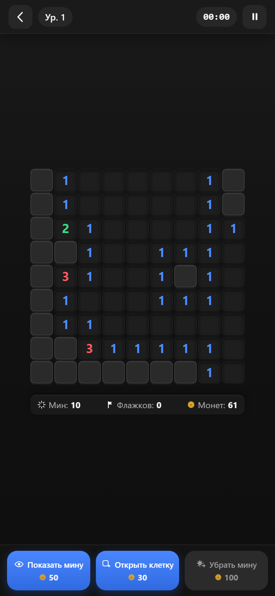
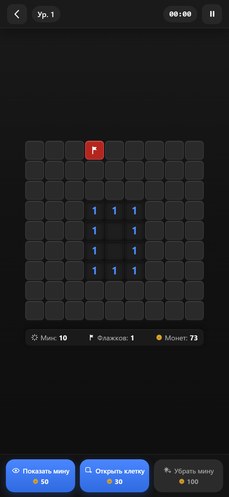
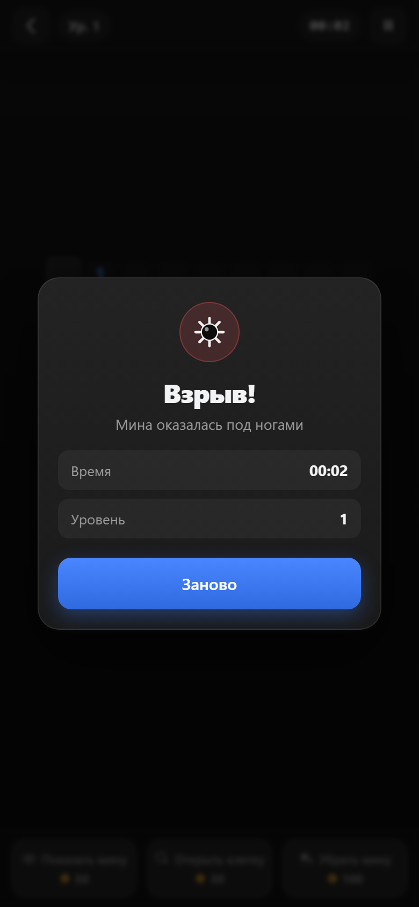
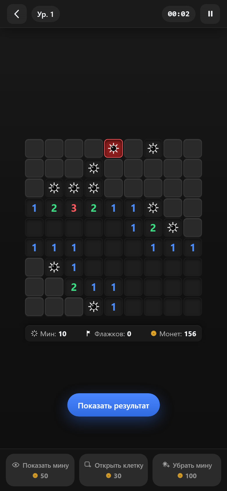
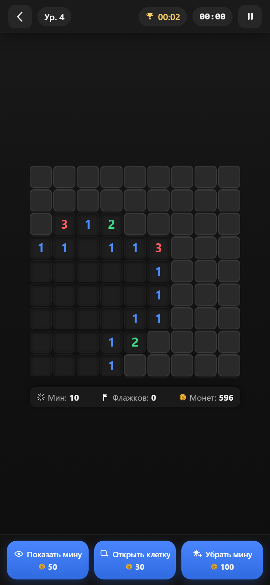
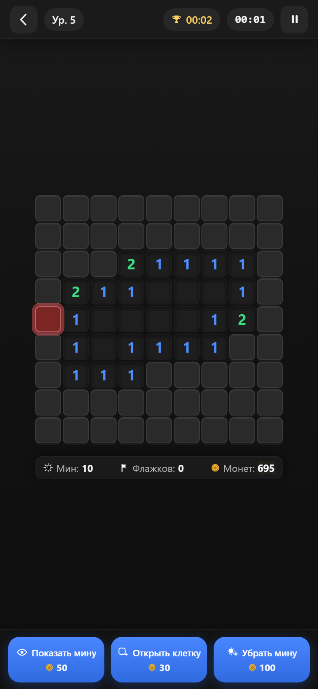
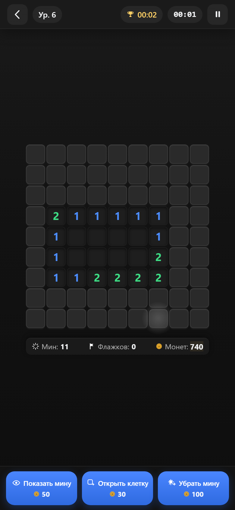
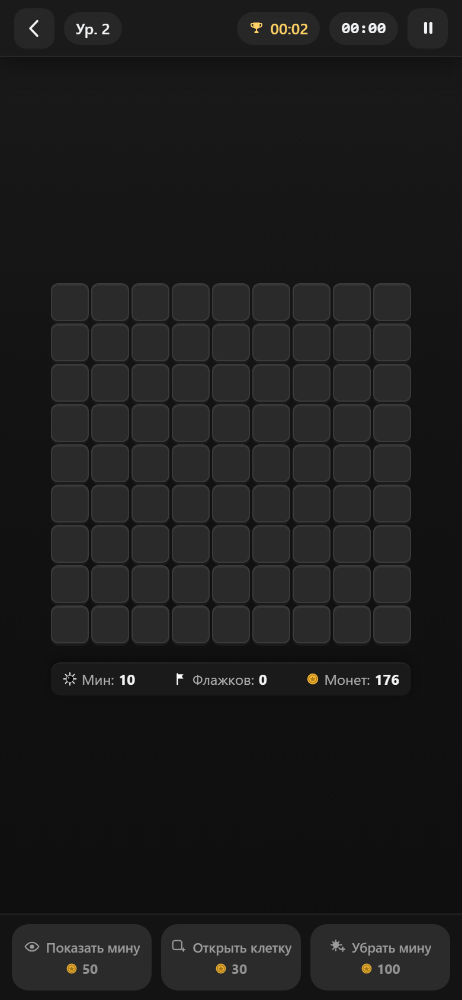

# Сапёр: Магазин (saper-vk)

Классический сапёр 9×9 с мета-прогрессией: монеты за открытые клетки и магазин подсказок.
Формат — **VK Mini App** (мобильный веб-вью внутри ВКонтакте), поэтому всё заточено под
вертикальный экран телефона: крупные тапы, тёмная тема, safe-area.

Стек: **React 19 + TypeScript (strict) + Vite**. Без сторонних UI- и анимационных библиотек —
только CSS и инлайновые SVG. Звук — Web Audio API, без файлов. Из внешнего есть только
`@vkontakte/vk-bridge` (инициализация мини-приложения и хранилище прогресса).

| Старт | Каскад | Флажок |
| --- | --- | --- |
|  |  |  |

| Взрыв | Поле после взрыва | Победа |
| --- | --- | --- |
|  |  |  |

| Магазин (всё доступно) | «Показать мину» | «Убрать мину» |
| --- | --- | --- |
|  |  |  |

| После победы и перезагрузки: уровень 2, рекорд, монеты | После траты 100 монет и перезагрузки |
| --- | --- |
|  |  |

## Статус проекта

| Шаг | Что делает | Состояние |
| --- | --- | --- |
| 1 | Каркас (Vite + React + TS), типы, генерация поля, открытие/флажки, тесты | ✅ готово |
| 2 | Визуал: тёмная тема, клетки, анимации, TopBar, таймер, пауза, монеты | ✅ готово |
| 3 | Магазин подсказок, строка статуса, сохранение звука в VK Storage | ✅ готово |
| 4 | VK-интеграция: монеты, уровень, рекорд в VK Storage | ✅ готово |
| 5 | README: сборка, деплой, создание Mini App, локальная отладка без туннеля | ✅ готово |

## Быстрый старт

```bash
npm install      # или: pnpm install
npm run dev      # http://localhost:5173
npm run build    # production-сборка в dist/
npm run preview  # локальный просмотр собранной версии
npm test         # тесты (vitest)
npm run typecheck
```

Требуется Node.js 20.19+ / 22.12+ (нужно для Vite 7).

## Деплой

Приложению нужен **HTTPS**: ВКонтакте открывает мини-приложение в iframe и не примет
незащищённый адрес. Серверная часть не нужна — `npm run build` собирает статику в `dist/`.

### Vercel

1. Залей проект в GitHub.
2. [vercel.com](https://vercel.com) → **Add New… → Project** → выбери репозиторий.
3. Framework Preset: **Vite**, Build Command: `npm run build`, Output Directory: `dist`.
4. **Deploy** → получишь `https://<проект>.vercel.app`.

### Netlify

1. [app.netlify.com](https://app.netlify.com) → **Add new site → Import an existing project**.
2. Build command: `npm run build`, Publish directory: `dist`.
3. **Deploy site**.

### GitHub Pages

1. В `vite.config.ts` уже стоит `base: './'` — сборка работает и из подкаталога.
2. `npm run build`
3. Опубликуй содержимое `dist/` в ветку `gh-pages`:
   ```bash
   npx gh-pages -d dist
   ```
   либо через Actions (`actions/upload-pages-artifact` + `actions/deploy-pages`).
4. Settings → Pages → Source: ветка `gh-pages`.
   Адрес: `https://<логин>.github.io/<репозиторий>/`.

### Любой другой хостинг

`dist/` — обычная статика, подойдёт любой HTTPS-хостинг (Cloudflare Pages, S3 + CloudFront,
свой nginx с сертификатом). Для локальной проверки сборки — `npm run preview`
(`http://localhost:4173`), но для ВК нужен публичный HTTPS.

## Как создать Mini App во ВКонтакте

1. **Приложение.** [dev.vk.com](https://dev.vk.com) → «Мои приложения» → «Создать
   приложение» → тип **Mini App** (мобильное веб-вью). Укажи название и платформу.
2. **URL.** В настройках приложения найди поле **«Адрес приложения» / Base URL** и вставь
   HTTPS-адрес из деплоя (например `https://saper-vk.vercel.app`). Если приложение живёт
   в подкаталоге (GitHub Pages), укажи полный путь со слэшем на конце.
3. **Иконки.** В настройках → «Иконки»: загрузи квадратные PNG 16, 24, 32, 48, 64, 128 и
   256 px. Они нужны для каталога мини-приложений и обложки.
4. **VKWebAppInit** уже вызывается в `src/main.tsx` — это обязательный шаг, без него
   приложение не откроется внутри ВК. Если ВК не ответил за 2 секунды, игра стартует
   на localStorage (проверено: вне ВК она полностью работоспособна).
5. **Локальная отладка внутри ВК (VK Tunnel).** Важно: **VK Tunnel недоступен** — с 2 октября
   2025 года сервис на технических работах и возвращает ошибку (это указано в
   [официальной инструкции](https://dev.vk.com/ru/mini-apps/getting-started)). Варианты:
   - **проще всего** — задеплоить на Vercel/Netlify и открывать `https://vk.com/app<APP_ID>`;
   - для локальной сборки — сторонний туннель с публичным HTTPS
     (`ngrok http 5173` или `cloudflared tunnel --url http://localhost:5173`), а полученный
     адрес указать в **«Режим разработки»**.
6. **Приоритет адресов.** Для администраторов адрес выбирается так: тестовая группа →
   **режим разработки** → **URL**. Поэтому перед проверкой боевой сборки **выключи «Режим
   разработки»** во всех площадках, иначе ты как админ продолжишь видеть старый адрес.
7. **Проверка на телефоне.** Открой приложение в мобильном ВК: тёмная тема, safe-area,
   таймер, магазин подсказок. Перезагрузи приложение — монеты, уровень и рекорд должны
   остаться. Неопубликованное приложение в мобильном ВК открывается так: отправь ссылку
   `https://vk.com/app<APP_ID>` в «Избранное» и запусти её оттуда.
8. **Чего настраивать не нужно:** CORS (VK Bridge общается через `postMessage`, а не через
   XHR), «Доверенный redirect URL» и «Базовый домен» (это поля приложений типа «Веб-сайт»),
   защищённый ключ (пока нет сервера). Единственное, чего стоит избегать, — заголовки
   `X-Frame-Options: DENY` и CSP `frame-ancestors 'none'`: с ними приложение не загрузится
   в `<iframe>` на vk.com. У Vercel и Netlify по умолчанию таких заголовков нет.

## Структура

```
saper-vk/
├─ src/
│  ├─ game/
│  │  ├─ types.ts     Cell, Board, GameState, LastEvent, ShopItem, ProgressPersistence
│  │  ├─ random.ts    детерминированный PRNG (mulberry32) + shuffle + deriveSeed
│  │  ├─ clock.ts     часы партии: старт / пауза / стоп / формат MM:SS
│  │  ├─ board.ts     генерация поля, мины, цифры, удаление мины, геометрия
│  │  ├─ reveal.ts    открытие, каскад, флажки, монеты, победа/проигрыш
│  │  ├─ shop.ts      каталог подсказок, выбор цели, применение
│  │  ├─ progress.ts  что сохраняем между сессиями и как разбираем хранилище
│  │  └─ useGame.ts   стейт-машина: редьюсер + хук (часы, таймеры, звук, сохранение)
│  ├─ audio/sfx.ts    синтез звуков на Web Audio API (клик, бум, победа, пшик, подсказка)
│  ├─ vk/
│  │  ├─ bridge.ts    VKWebAppInit + обёртки VKWebAppStorage
│  │  └─ storage.ts   прогресс: VK Storage внутри ВК, localStorage в браузере
│  ├─ components/
│  │  ├─ TopBar.tsx        уровень, рекорд, таймер, пауза, назад
│  │  ├─ Board.tsx         сетка 9×9 + волна раскрытия + тряска
│  │  ├─ Cell.tsx          клетка: тап/удержание, анимации
│  │  ├─ StatusBar.tsx     мин / флажков / монет под полем
│  │  ├─ ShopBar.tsx       три кнопки подсказок
│  │  ├─ GameOverModal.tsx «Взрыв!» / «Победа!»
│  │  ├─ PauseModal.tsx    пауза: продолжить / заново / звук
│  │  ├─ Modal.tsx         каркас оверлея (+ подсмотр поля)
│  │  ├─ Confetti.tsx      30 точек на CSS
│  │  ├─ Toast.tsx         всплывашка снизу
│  │  └─ icons.tsx         инлайновые SVG-иконки
│  ├─ hooks/useToast.ts
│  ├─ App.tsx, main.tsx, styles.css
│  └─ vite-env.d.ts
├─ tests/             board, reveal, useGame, clock, shop, progress, bridge, playthrough (111 тестов)
├─ scripts/screenshot.mjs   скриншоты состояний + проверка прогресса через CDP
├─ index.html, vite.config.ts, tsconfig.json, package.json
```

## Правила игры

- Поле 9×9. Сложность по уровню: 1–5 → 10 мин, 6–10 → 12 мин, 11+ → 15 мин.
- **Мины расставляются на первом клике**, поэтому первая открытая клетка всегда безопасна.
  Вместе с ней свободна и её 3×3 зона — первый клик открывает область, а не «цифру 1».
- Пустые клетки открываются каскадом (итеративно, обход в ширину).
- **Монеты:** +1 за каждую открытую безопасную клетку (каскад считается), +50 бонусом за победу.
- **Таймер** стартует на первом открытии, останавливается на паузе и на экране результата.
  **Рекорд** — лучшее время, одно число на все уровни.
- Флажок — удержание клетки (≈380 мс) или правый клик. На открытую клетку флажок не ставится.
- **Победа** — когда открыты все безопасные клетки (флажки в условии победы не участвуют);
  оставшиеся мины помечаются флажками автоматически.
- **Проигрыш** — клик по мине: вспышка клетки, тряска поля, раскрытие всех мин.
- На экране результата тап мимо карточки прячет оверлей — поле можно рассмотреть
  (кнопка «Показать результат» возвращает карточку).

## Магазин подсказок

Магазин доступен только в идущей партии: до первого клика мин ещё нет, после победы или
проигрыша подсказки бессмысленны. Если монет не хватает, кнопка выглядит неактивной, но
остаётся нажимаемой — тап объясняет причину тостом «Не хватает монет». Монеты списываются
только за реально применённую подсказку (если цели на поле нет — тост и никакого списания).

| Подсказка | Цена | Что делает |
| --- | --- | --- |
| Показать мину | 50 | Подсвечивает одну случайную закрытую мину красной пульсацией 2 секунды. Клетка остаётся закрытой: ни открытия, ни флажка. Тап по ней — обычный ход (взрыв, если это мина). |
| Открыть клетку | 30 | Открывает ровно одну случайную безопасную клетку. Каскад не запускается, монеты за неё не начисляются. |
| Убрать мину | 100 | Мина исчезает с белым дымком; счётчик «Мин» уменьшается, у всех соседей пересчитываются цифры. Если на клетке стоял флажок — он снимается. |

После «Убрать мину» число безопасных клеток растёт (71 → 72), и победа наступает уже
по новому порогу `openedSafe === safeTotal` — это проверено тестом вместе с пересчётом цифр.

## Сохранение прогресса

Внутри ВКонтакте — `VKWebAppStorage`, в обычном браузере — `localStorage` с префиксом
`saper:`. Решение о бэкенде принимается после инициализации моста: мини-приложение ВК
всегда открывается в iframe, поэтому вне ВК сразу берётся localStorage (без ожидания таймаута).

| Ключ | Когда сохраняется | Что даёт при следующем запуске |
| --- | --- | --- |
| `coins` | после каждого изменения: открыл клетку, потратил на подсказку, получил бонус | монеты на месте |
| `level` | при победе (сохраняется **следующий** уровень) | выиграл 1-й — начинаешь со 2-го |
| `bestTime` | при победе, если время меньше прежнего | рекорд виден в TopBar (золотая плашка) |
| `soundEnabled` | при переключении в модалке паузы | звук остаётся выключенным |

Пишем не «в конце уровня», а сразу после изменения — игрок может закрыть ВКонтакте в любой
момент. Тики часов прогресс не трогают: запись идёт только когда значения реально изменились
(`isSameProgress`). Разбор значений терпимый: мусор, отрицательные числа и чужие форматы
заменяются значениями по умолчанию, поэтому испорченное хранилище не ломает игру.

## Визуал

Тёмная тема без «плоскости»: градиент фона `#1A1A1A → #121212 → #0E0E0E`, закрытая клетка
`#2A2A2A` с обводкой `#3A3A3A` и объёмной тенью `0 2px 0 #1A1A1A`, открытая — `#1E1E1E`
с утопленной тенью `inset 0 2px 4px rgb(0 0 0 / 50%)`. Цифры — классические цвета
(1 синий, 2 зелёный, 3 красный, 4 фиолетовый, 5 оранжевый, 6+ белый). Строка статуса —
28 px, `#1A1A1A` с тенью сверху, по ширине поля (304 px).

Анимации (чистый CSS):

| Событие | Анимация |
| --- | --- |
| Открытие клетки | `wave-in` 0.15 с, scale 1.1 → 1.0 |
| Каскад | волна: задержка `ring × 45 мс` от точки клика (потолок 360 мс) |
| Флажок | `flag-pop` 0.3 с, `cubic-bezier(0.34, 1.56, 0.64, 1)` |
| Взрыв | красная вспышка клетки 0.3 с + тряска поля 0.3 с, амплитуда 4–6 px |
| Подсказка «Показать мину» | 4 пульса по 0.5 с (итого 2 с) + статичный красный тон |
| Подсказка «Убрать мину» | белый дымок 0.5 с |
| Победа | конфетти из 30 точек |
| Нажатия кнопок | `scale(0.95)` |

При `prefers-reduced-motion: reduce` все анимации отключаются; подсветка подсказки при этом
остаётся видимой (статичный тон), потому что она несёт игровую информацию, а не декор.

### Про волну каскада

В ТЗ было «0.1 с между клетками каскада», но каскад из 54 клеток тогда раскрывался бы 5.4 с,
а исходное требование к каскаду — «без задержек». Поэтому задержка считается не по порядку
клеток, а по **расстоянию от точки клика** (`ring` из обхода в ширину): 45 мс на кольцо,
весь каскад — около 0.3 с. Логика при этом срабатывает мгновенно, задерживается только
визуальное раскрытие. Крутится двумя константами в `src/components/Board.tsx`:
`WAVE_STEP_MS` и `WAVE_MAX_DELAY_MS`.

## Тесты

```bash
npm test     # 111 тестов в 8 файлах
```

Покрыто: безопасный первый клик (100 генераций, все 81 вариант, углы на сложном уровне),
корректность цифр относительно независимого эталонного подсчёта, каскад, флажки, монеты,
часы (старт/пауза/стоп/рекорд), волна раскрытия, победа/проигрыш, все три подсказки,
сохранение прогресса (сериализация, мусор в хранилище, правило «после победы — следующий
уровень»), определение площадки (ВК или браузер — от этого зависит бэкенд хранилища),
иммутабельность (действия на глубоко замороженном состоянии).

Отдельно проверяется сценарий «убрал мину → цифры пересчитались»: мин стало 9, у соседа
цифра уменьшилась на 1 (и это видно сразу, до открытия), безопасных клеток стало 72,
открытие соседа показывает новую цифру, победа наступает при `openedSafe === 72`.

`tests/playthrough.test.ts` печатает партию ASCII-рендером.

### Проверка перезагрузкой

Юнит-тестом не проверить, что прогресс переживает перезагрузку страницы, поэтому это делает
скрипт скриншотов — он доводит приложение до нужных состояний через отладочный мост и падает,
если что-то не сошлось:

```
14-progress-start            → уровень 1, монеты 0 (хранилище очищено)
15-coins-after-move          → монеты 49, в хранилище "49"
16-coins-after-reload        → перезагрузка: монеты 49          ✓
17-win-saved                 → победа на 1-м уровне, в хранилище level "2", bestTime "2670"
18-win-after-reload          → перезагрузка: уровень 2, рекорд 2670, монеты совпали  ✓
19-coins-after-spend         → «Убрать мину»: 227 → 127 (ровно −100), minesRemoved 1
20-coins-after-spend-reload  → перезагрузка: монеты 127, уровень 2                    ✓
```

```bash
VITE_DEV_BRIDGE=1 npm run build   # сборка с отладочным мостом window.__SAPER__ и сценариями ?dev=
node scripts/screenshot.mjs http://127.0.0.1:4173 screenshots
```

`scripts/screenshot.mjs` снимает состояния через Chrome DevTools Protocol с телефонным
вьюпортом 390×844 (DPR 2, mobile) — так же, как это увидит игрок в веб-вью ВКонтакте —
и печатает фактические размеры узлов и значения в хранилище. Обычная сборка собирается
**без** моста и сценариев: они отрезаются по `import.meta.env`.

## Ключевые архитектурные решения

1. **Случайность выводится из `seed`, а не из `Math.random` внутри логики.**
   `GameState.seed` — единственный источник энтропии; расстановка мин и выбор цели для
   подсказок детерминированы (`createRng(deriveSeed(seed, moveId))`). Поэтому редьюсер —
   чистая функция: одинаковый вход даёт одинаковый выход (важно для React StrictMode),
   тесты воспроизводимы, а партию можно повторить по зерну.
2. **Время приходит в действиях (`now`), а не читается внутри редьюсера.** Часы хранят
   «накопленное + момент старта отрезка», поэтому пауза и завершение партии просто
   останавливают отрезок, а точность рекорда не зависит от частоты тиков.
3. **События последнего хода (`lastEvent`) отделяют логику от презентации.** Домен не знает
   про анимации: он лишь сообщает, что открылось (с расстоянием от точки клика), что
   поставлен флажок, где рвануло, что подсвечено подсказкой или убрана мина. Компоненты
   превращают это в CSS-анимации, хук — в звук.
4. **Порт `ProgressPersistence` вместо прямых вызовов VK.** Игровая логика не знает, где
   лежит прогресс: `useGame` принимает порт, приложение передаёт реализацию из `src/vk`.
   В тестах порт можно не передавать вообще — игра работает в памяти.
5. **Иммутабельность.** Все объекты `readonly`; изменение состояния — новый массив/объект.
   Если ход невозможен, функция возвращает **тот же** объект состояния — React не
   перерисовывает поле зря. Мутации запрещены на уровне типов и проверены тестами на
   глубоко замороженном состоянии.
6. **Строгий TypeScript.** `strict`, `noUncheckedIndexedAccess`, `exactOptionalPropertyTypes`,
   `noUnusedLocals/Parameters`, `verbatimModuleSyntax`. Ни одного `any`.
